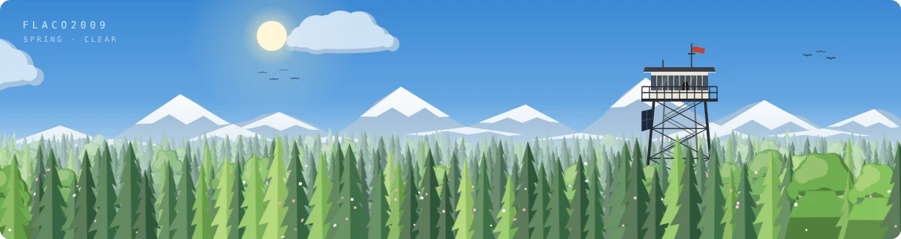
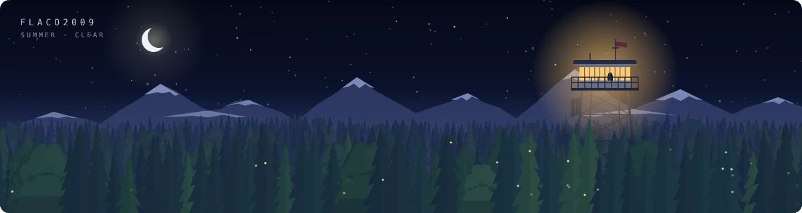
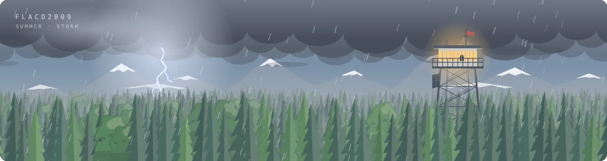
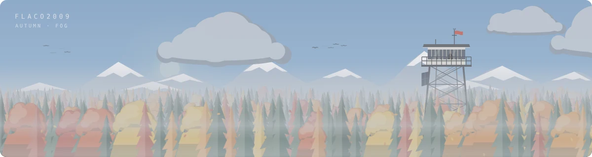
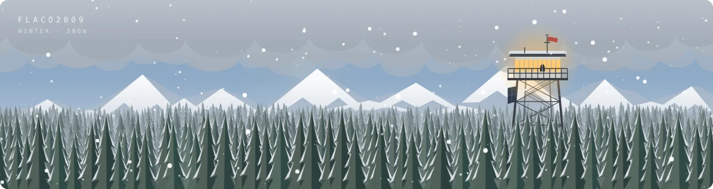
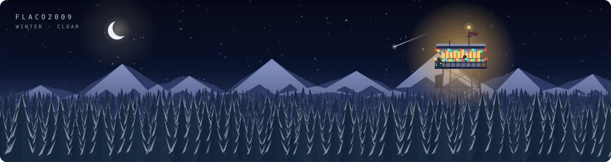

  &nbsp;
  &nbsp;
  

<b>About this banner</b>

 

A fire lookout above a sea of treetops. The banner redraws itself every 30 minutes and follows the real world:

| | |
|---|---|
| **Time** | sun and moon follow the real sun position at your place, dusk, stars, shooting stars |
| **Season** | spring blossoms, summer fireflies, autumn larches turn gold, winter snow |
| **Weather** | random, changes every 3 hours: clear, cloudy, rain, thunderstorm, fog, snow |
| **December** | string lights on the tower, a tiny tree on the catwalk, a star on the antenna |

<table>
<tr>
<td> Spring morning</td>
<td> Summer night</td>
</tr>
<tr>
<td> Thunderstorm</td>
<td> Autumn fog</td>
</tr>
<tr>
<td> Snowfall</td>
<td> December night</td>
</tr>
</table>

### Customize it

The buttons above open the playground. Pick weather, season, time, name and place, choose how long it should last and hit **Save**. GitHub opens with a prefilled issue, you click **Create**, and about a minute later your profile banner is updated. **Reset to auto** brings everything back to automatic. Only the owner of the repo can change it.

### Get your own

1. [Create a repo from this template](https://github.com/new?template_name=Flaco2009&template_owner=Flaco2009), name it **exactly like your GitHub username** and make it **public**
2. Done. Within 30 minutes the banner shows up on your profile with your name
3. Open the [playground](https://flaco2009.github.io/Flaco2009/), enter your username, set your place and save

Everything is drawn by [`generate.py`](generate.py) as an animated SVG, no images or libraries. A [GitHub Action](.github/workflows/banner.yml) re-renders it every 30 minutes, settings live in [`config.json`](config.json).

