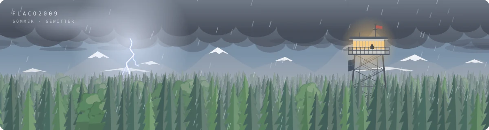
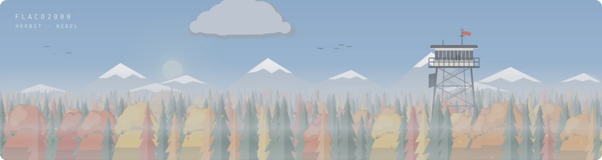

  &nbsp;
  &nbsp;
  

<b>Über diesen Banner</b>

 

Ein Feuerwachturm über einem Meer aus Baumspitzen. Der Banner baut sich alle 30 Minuten neu und folgt dabei der echten Welt:

| | |
|---|---|
| **Uhrzeit** | Sonne und Mond nach dem echten Sonnenstand in Zürich, Dämmerung, Sterne, Sternschnuppen |
| **Jahreszeit** | Frühling blüht, Sommer mit Glühwürmchen, Herbst färbt die Lärchen, Winter verschneit |
| **Wetter** | zufällig, wechselt alle 3 Stunden: klar, wolkig, Regen, Gewitter, Nebel, Schnee |
| **Dezember** | Lichterketten am Turm, Mini-Baum auf dem Umlauf, Stern auf der Antenne |

<table>
<tr>
<td> Frühlingsmorgen</td>
<td> Sommernacht</td>
</tr>
<tr>
<td> Gewitter</td>
<td> Herbstnebel</td>
</tr>
<tr>
<td> Schneefall</td>
<td> Dezembernacht</td>
</tr>
</table>

Alles wird von [`generate.py`](generate.py) als animiertes SVG gezeichnet, ohne Bilder oder Libraries. Eine [GitHub Action](.github/workflows/banner.yml) rendert es alle 30 Minuten neu.

